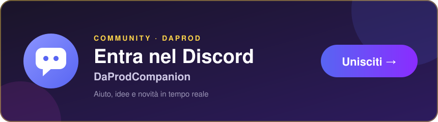

<!-- discord-card -->
<p align="center">
  <a href="https://discord.gg/Njs52aacwq"></a>
</p>

# DaProdCompanion

[](https://discord.gg/Njs52aacwq)

Un companion AI desktop 100% locale, in italiano: un avatar che vive sul tuo desktop, ti ascolta,
ti risponde, si ricorda di te nel tempo e — quando non gli parli — pensa comunque da solo a quello
che ha imparato. Nessun dato lascia il PC: il cervello (Ollama), la voce (Kokoro) e l'orecchio
(faster-whisper) girano tutti in locale.

Architettura di riferimento (scritta prima di iniziare, non tutta ancora attuale):
[docs/architecture/architettura.md](docs/architecture/architettura.md).

C'e' anche un primissimo abbozzo Android (Gemma 3n E2B interamente sul telefono, zero dipendenza
dal PC): vedi [android/README.md](android/README.md) — per ora solo uno scheletro che compila,
non ancora provato su un dispositivo vero.

## Stato (v0.0.1)

Prima release taggata, pensata per essere provata e per raccogliere feedback — non e' un
prodotto "finito e inscatolato": manca un installer (si avvia da sorgente con `uv`/`npm`), manca
la Fase Webcam/riconoscimento facciale, e ci sono ancora bug noti in fase di rifinitura.

| Area | Cosa c'e' |
|---|---|
| **Core** | Sandboxing filesystem obbligatorio, SQLite (WAL + `sqlite-vec`), loop di conversazione via Ollama |
| **Avatar** | Overlay trasparente sempre in primo piano, stati visivi (ascolto/pensa/parla/sogna/sente il proprio nome), trascinabile, pulsanti compatti, anteprima live di quello che dici, bolla che mostra sempre sia il messaggio ricevuto sia la risposta, cronologia consultabile |
| **Voce** | Ascolto continuo con wake-word configurabile, finestra di conversazione senza ripetere il nome, push-to-talk, modalita' live, calibrazione del riconoscimento nome, filtro allucinazioni Whisper |
| **Memoria e dreaming** | Consolidamento periodico (notturno / per inattivita' / per dimensione) di memoria episodica -> semantica + grafo, sospeso mentre ascolta/registra, annuncio (testo + voce) di cosa ha sognato |
| **Cervellone (grafo)** | Fisica personalizzabile (repulsione/attrazione), filtri per tipo entita' e nodi isolati, dimensione nodi in base ai collegamenti, timer sogni |
| **Export in markdown** | Ogni entita' diventa una nota con frontmatter YAML (stile vault Obsidian), diario dei sogni, pagina "chi sono" auto-scritta |
| **Tool-use ristretto** | Il modello puo' salvare una memoria al volo o interrogare il grafo durante la chat — niente esecuzione di codice, niente filesystem oltre al wrapper di sandboxing |
| **Modalita' Quantum** | Vedi sotto |
| **Impostazioni** | Nome del companion, scelta del modello Ollama tra quelli gia' scaricati, voce/velocita' TTS, microfono, calibrazione wake-word, reset completo |

## La modalita' Quantum, spiegata bene

Il dreaming normale e' *reattivo*: si sveglia quando smetti di parlare, o quando passa troppo
tempo, e riassume quello che e' successo. La modalita' Quantum e' l'opposto: e' il companion che
decide da solo di mettersi a **pensare al proprio grafo di conoscenza senza che sia successo
niente di nuovo** — non riassume una conversazione, esplora quello che sa gia' e cerca di
collegarlo meglio.

Come funziona, un ciclo alla volta:

1. **La attivi tu** dal pulsante "Modalita' Quantum" nel pannello del cervellone.
2. Ad ogni iterazione (fino a **20** per attivazione, un tetto di sicurezza) il companion guarda
   il grafo attuale — quali entita' esistono, come sono collegate, quali sono isolate — e prova a
   trovare **un solo** collegamento nuovo e plausibile, oppure ad aggiungere **una sola** entita'
   nuova strettamente legata a una gia' esistente. Gli viene detto esplicitamente di non
   inventare nulla che non sia deducibile dal grafo stesso.
3. Ogni iterazione produce un piccolo "insight" (una frase su cosa ha appena collegato e perche'),
   visibile nel pannello del cervellone mentre gira.
4. **Mentre e' attiva, il companion non fa nient'altro**: l'ascolto vocale e' mutato e il dreaming
   normale e' sospeso, cosi' non competono per lo stesso modello Ollama ne' per lo stesso
   microfono. Una richiesta in chat testuale durante questo periodo riceve una risposta di
   cortesia ("sto rielaborando i miei ricordi") invece di una vera risposta.
5. **La fermi tu** (o si ferma da sola dopo 20 iterazioni). Prima di uscire davvero, il companion
   scrive una breve **nota di handoff**: cosa ha esplorato, cosa varrebbe la pena approfondire la
   prossima volta. La legge lui stesso all'inizio della successiva attivazione, cosi' non riparte
   sempre da zero — e' l'unica cosa che sopravvive tra un'attivazione Quantum e l'altra, oltre al
   grafo stesso.

In breve: il dreaming e' "cosa ho appena vissuto", Quantum e' "cosa posso capire meglio di quello
che gia' so", ed e' pensata per essere un'attivita' che *scegli* di fargli fare (tipo lasciarlo
"studiare" per un po'), non qualcosa che gira in automatico in sottofondo.

## Avvio (uso normale, dopo la prima installazione)

```powershell
cd app
npm start
```

Electron compila (se serve) e avvia `brain_service`, `tts_service` e `stt_service` come processi
figli supervisionati. Per chiudere tutto: icona nella system tray (vicino all'orologio) -> tasto
destro -> Esci.

## Prima installazione

Prerequisiti:

- [uv](https://docs.astral.sh/uv/) e Node.js/npm
- [Ollama](https://ollama.com/) in esecuzione, con almeno un modello per la chat scaricato (es.
  `ollama pull gemma4:e4b-it-qat`) e `ollama pull nomic-embed-text` per gli embedding
- [eSpeak NG](https://github.com/espeak-ng/espeak-ng) installato (`winget install
  eSpeak-NG.eSpeak-NG` su Windows), necessario per la sintesi vocale italiana di Kokoro

```powershell
copy .env.example .env
uv sync --all-packages
cd app
npm install
npm start
```

Al primo avvio viene chiesto il nome del companion (default proposto: "Babbasone"): determina la
cartella dedicata creata su `Desktop\<nome>\`, dove vivono database, log, audio generato, memorie
esportate in markdown e grafo — mai dentro al repo. Il modello Ollama da usare si sceglie (o si
cambia in seguito) dal menu Impostazioni, tra quelli gia' scaricati in locale.

## Solo backend, senza interfaccia (utile per debug)

```powershell
.\scripts\dev-up.ps1
```

```powershell
curl http://127.0.0.1:8770/health
curl -X POST http://127.0.0.1:8770/chat -H "Content-Type: application/json" -d "{\"message\": \"ciao\"}"
```

## Test

```powershell
uv run pytest services/brain/tests services/stt/tests shared/tests -q
cd app; npm run build
```

## Cosa manca per una versione davvero "inscatolata"

- Installer offline (electron-builder, runtime Python bundlato, niente `uv`/`npm` richiesti
  all'utente finale)
- Fase Webcam / riconoscimento facciale (mai iniziata)
- Streaming reale della sintesi vocale (oggi Kokoro sintetizza l'intera risposta prima di
  riprodurla)
